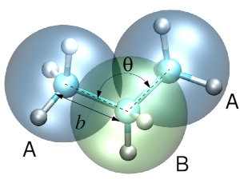

Introduction
============

Versatile Object-oriented Toolkit for Coarse-graining Applications, or
VOTCA, is a package which helps to systematically coarse-grain various
systems [Ruehle:2009.a]_. This includes deriving the
coarse-grained potentials, assessing their quality, preparing input
files required for coarse-grained simulations, and analyzing the latter.

A typical coarse-graining workflow includes *sampling* of the system of
interest, *analysis* of the trajectory using a specific *mapping* and a
coarse-graining *method* to derive coarse-grained potentials.

.. _introduction_fig_propane:

    Three-bead coarse-grained model of propane.

The workflow can be exemplified on coarse-graining of a propane liquid.
A single molecule of propane contains three carbon and eight hydrogen
atoms. A united atom coarse-grained representation of a propane molecule
has three beads and two bead types, A and B, with three and two
hydrogens combined with the corresponding atom, as shown in
the figure above. This representation defines the *mapping*, as well as
the bonded coarse-grained degrees of freedom, such as the bond :math:`b`
and the bond angle :math:`\theta`. Apart from the bonded interactions,
:math:`u_b` and :math:`u_\theta`, beads belonging to different molecules
have non-bonded interactions, :math:`u_\text{AA}`, :math:`u_\text{AB}`,
:math:`u_\text{BB}`. The task of coarse-graining is then to derive a
potential energy surface :math:`u` which is a function of all
coarse-grained degrees of freedom. Note that, while the atomistic bond
and angle potentials are often chosen to be simple harmonic functions,
the coarse-grained potentials cannot be expressed in terms of simple
analytic functions. Instead, tabulated functions are normally used.

The coarse-graining *method* defines criteria according to which the
potential energy surface is constructed. For example, for the bond
:math:`b` and the angle :math:`\theta` Boltzmann inversion can be used. In this case a
coarse-grained potential will be a potential of mean force. For the
non-bonded degrees of freedom, structure-based methods such as iterative
Boltzmann inversion or inverse Monte Carlo aim at radial distribution
functions of the coarse-grained model that match those of the atomistic
model; VOTCA provides the distributions (``csg_stat``) and the update steps
for inverse Monte Carlo (``csg_imc_solve``) and relative entropy
(``csg_reupdate``), while the iteration has to be scripted by the user.
For these methods and their variants see iterative Boltzmann inversion
[Reith:2003]_, its Kirkwood-Buff [Ganguly:2012]_, [Kirkwood:1951]_ and
cumulative-coordination [deOliveira:2016]_ variants, inverse Monte Carlo
[Lyubartsev:1995]_, [Murtola:2007]_ and Newton inversion
[lyubartsev2010systematic]_, Newton and integral-equation methods for the
inverse Henderson problem [Delbary:2020]_, [Bernhardt:2021]_, and the
comparison in [Rosenberger:2016]_.
Alternatively, force matching (or multiscale coarse-graining, ``csg_fmatch``)
can be used, in which case the coarse-grained potential
will approximate the many-body potential of mean force. The choice of a
particular method is system-specific and requires a thorough consistency
check. It is important to keep in mind that coarse-graining should be
used with understanding and caution [Wang:2009]_, methods should be crossed-checked
with each other as well as with respect to the reference system.

The package consists of a C++ library and command-line tools. They
process atomistic topologies and trajectories and offer a flexible
framework for reading, manipulating and analyzing topologies and
trajectories generated by MD/SD/MC sampling. It is modular: new file formats can be integrated without
changing the existing code. Currently, interfaces for
GROMACS [gromacs4]_, LAMMPS [lammps]_ and DL_POLY topologies and trajectories
are provided. The tools include calculations of probability distributions
of bonded and non-bonded interactions, force matching, and updates for the
coarse-grained pair potential.

Before using the package, do not forget to initialize the variables in
the bash

.. code:: bash

      source <csg-installation>/bin/VOTCARC.bash

More details as well as several examples can be found in
ref. [Ruehle:2009.a]_. If you are using the package, please cite
[Baumeier:2024]_ and [Ruehle:2009.a]_.
