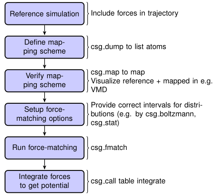

Methods
#######

Force matching
==============

.. _methods_fig_fm_flowchart:

   Flowchart to perform force matching.

The force matching algorithm with cubic spline basis is implemented in
the utility ``csg_fmatch``. A list of available options can be found in the
reference section (:ref:`reference_programs`) or with ``csg_fmatch --help``.

.. _methods_fm_program_input:

Program input
-------------

``csg_fmatch`` needs an atomistic reference run to perform coarse-graining. Therefore,
the trajectory file *must contain forces* (note that there is a suitable
option in the GROMACS ``.mdp`` file), otherwise ``csg_fmatch`` will not be able to
run.

In addition, a mapping scheme has to be created, which defines the
coarse-grained model (see :ref:`input_files`). At last, a control
file has to be created, which contains all the information for
coarse-graining the interactions and parameters for the force-matching
run. This file is specified with the option ``--options`` in XML format. An
example might look like the following

.. code:: xml

  <cg>
    <!--fmatch section -->
    <fmatch>
      <!--Number of frames for block averaging -->
      <frames_per_block>6</frames_per_block>
      <!--Constrained least squares?-->
      <constrainedLS>false</constrainedLS>
    </fmatch>
    <!-- example for a non-bonded interaction entry -->
    <non-bonded>
      <!-- name of the interaction -->
      <name>CG-CG</name>
      <type1>A</type1>
      <type2>A</type2>
      <!-- fmatch specific stuff -->
      <fmatch>
        <min>0.27</min>
        <max>1.2</max>
        <step>0.02</step>
        <out_step>0.005</out_step>
      </fmatch>
    </non-bonded>
  </cg>

The parameters ``min`` and ``max`` have to be chosen in such a way as
to avoid empty bins within the grid. Determining ``min`` and ``max`` by
using ``csg_stat`` is recommended (see :ref:`input_files_setting_files`). A full description
of all available options can be found in :ref:`reference_settings_file`.

.. _methods_fm_program_output:

Program output
--------------

``csg_fmatch`` produces a separate ``.force`` file for each interaction, specified in
the CG-options file (``--options``). These files have 4 columns
containing distance, corresponding force, the force error, which is
estimated via a block-averaging procedure, and a table flag. If you are
working with an angle, then the first column will contain the
corresponding angle in radians.

To get table-files for an MD package, the forces have to be integrated to
potentials, and extrapolated and possibly smoothed at the borders (see
:ref:`preparing_post-processing_of_the_potential`); VOTCA provides no tool for
these steps any more.

For dihedral (bonded) interactions, ``<fmatch><periodic>1</periodic></fmatch>``
in the interaction section enforces a periodic spline.

Output files are not only produced at the end of the program execution,
but also after every successful processing of each block. The user is
free to have a look at the output files and decide to stop ``csg_fmatch``, provided
the force error is small enough.

.. _methods_fm_threebody:

Three-body Stillinger-Weber interactions
----------------------------------------

As described in the theory section, ``csg_fmatch`` is also able to parametrize
the angular part of three-body interactions of the Stillinger-Weber type (see subsec. :ref:`theory_fm_threebody`).
The general procedure is the same, as shown in the two-body case
(See flowchart in Fig. :ref:`methods_fig_fm_flowchart`).
It has to be specified in the control file that one wants to parametrize a three-body interaction. An example might look like this:

.. code:: xml

   <cg>
     <!-- fmatch section -->
     <fmatch>
       <!-- Number of frames for block averaging -->
       <frames_per_block>10</frames_per_block>
       <!-- Constrained least squares?-->
       <constrainedLS>true</constrainedLS>
     </fmatch>
     <!-- example for a non-bonded interaction entry with three-body SW interactions -->
     <non-bonded>
       <!-- name of the interaction -->
       <name>CG-CG-CG</name>
       <!-- flag for three-body interactions -->
       <threebody>true</threebody>
       <!-- CG bead types (according to mapping file) -->
       <type1>A</type1>
       <type2>A</type2>
       <type3>A</type3>
       <!-- fmatch section of interaction -->
       <fmatch>
         <!-- short-range cutoff (in nm) -->
         <a>0.37</a>
         <sigma>1.0</sigma>
         <!-- switching range (steepness of exponential switching function) (in nm) -->
         <gamma>0.08</gamma>
         <!-- min for angular interaction (in rad) -->
         <min>0.7194247283</min>
         <!-- max for angular interaction (in rad) -->
         <max>3.1415927</max>
         <!-- step size for internal spline representation (in rad) -->
         <step>0.1</step>
         <!-- output step size for angular interaction (in rad) -->
         <out_step>0.0031415927</out_step>
       </fmatch>
     </non-bonded>
   </cg>

As in the case of pair interactions, the parameters ``min`` and ``max`` have to be chosen in such a
way as to avoid empty bins within the grid. Determining ``min`` and ``max`` by using 
``csg_stat`` is recommended (see sec. :ref:`input_files_setting_files`).

For each three-body interaction as specified in the CG-options file 
``--options``, ``csg_fmatch`` produces a separate ``.force`` file, as well as a
``.pot`` file. Due to the functional form of the Stillinger-Weber potential,
``csg_fmatch`` outputs the three-body force in angular direction, as well as the angular potential.
Therefore, in contrast to the two-body force, the angular
three-body force does not have to be numerically integrated. The ``.force``, as well as
the ``.pot`` file have 4 columns containing the angle in radians, the force or potential,
the error (which is estimated via a block-averaging procedure) and a table flag.

Coarse-grained simulations with three-body Stillinger-Weber interactions can be done with
LAMMPS with the MANYBODY *pair_style sw/angle/table* (https://docs.lammps.org/pair_sw_angle_table.html). For this, the ``.pot`` file has to be
converted into a table format according to the LAMMPS *angle_style table* (https://docs.lammps.org/angle_table.html).

Relative entropy
================

``csg_reupdate`` performs one update of the parameters of analytic or
cubic B-spline potentials by relative entropy minimization
[Shell2008]_, [mashayakrelative]_ (see also [Chaimovich2011]_,
[rudzinski_coarse-graining_2011]_, [lu_coarse-graining_2014]_, and
[Wu2005]_ for the related phase-space overlap measures). It needs the target distributions
of the atomistic system (e.g. from ``csg_stat``) and a trajectory of the
coarse-grained model with the current potentials; the iteration (running
the coarse-grained simulation with the new potentials, and repeating) has to
be scripted by the user. The settings file needs ``cg.inverse.kBT`` and
``cg.inverse.scale`` and, per interaction, the ``re`` section
(``function``: ``lj126``, ``ljg`` or ``cbspl``, and ``cbspl.nknots``);
``csg_reupdate --gentable true`` only writes the potential tables for given
parameters. See :ref:`reference_programs` and :ref:`reference_settings_file`.

Inverse Monte Carlo
===================

``csg_stat --do-imc`` computes, in addition to the distributions, the
cross-correlation matrices of the inverse Monte Carlo method
[Lyubartsev:1995]_ for all interactions of the same
``inverse.imc.group``; ``csg_imc_solve`` solves the resulting linear system
(optionally with Tikhonov regularization, ``--regularization``) for the
potential update. As for relative entropy, the update of the tables and the
iteration have to be done by the user.
