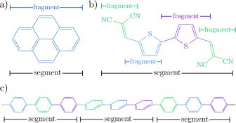
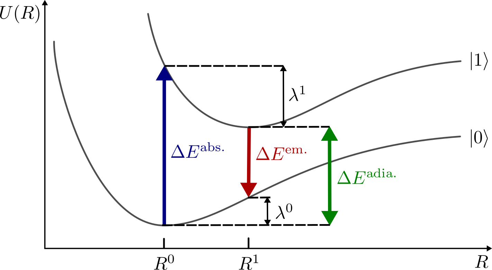
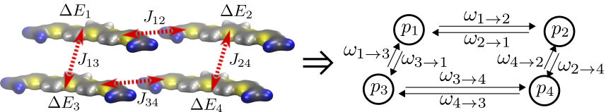

.. _sec_transport_theory:

Charge and Energy Transport Model
#################################

Partitioning of the system
**************************

Before the charge or exciton dynamics can be calculated using rate models, a given morphology has to be divided into sites, on which excitations localize. This requires knowledge of the localization of the electronic states, as each site should preferably contain a single diabatic state of the complete system. In detail knowledge of the localization requires electronic structure calculations of the whole system, which are not feasible for larger systems. Instead, the partitioning into segments can only be justified a posteriori by assessing the magnitude of the electronic couplings between segments. 

.. _fig_theory_fragment_def:

    Partitioning scheme as employed in VOTCA. a) For small, inflexible molecules, the whole molecule is replaced by a rigid fragment. b) For larger molecules, more fragments are used to allow for some flexibility for the slower degrees of freedom. The whole molecule is still one segment. c) For a polymer, the chain is cut into segments, using input from quantum mechanical studies. Each segment may also contain more than one rigid fragment.

In many systems chemical intuition allows defining partitioning, which satisfies this test retrospectively, e.g., in most organic electronic systems a conjugated system is a good minimal guess. As shown in :numref:`fig_theory_fragment_def` all atoms belonging to a single site are collectively referred to as a conjugate segment. 

In small molecule systems each molecule is typically chosen as a single conjugated segment, because electronic structure calculations typically show complete delocalization of electronic states over the individual molecules. In polymeric systems this simple approach may fail, as torsion of the backbone and electron-phonon interaction may lead to localization on polymeric subunits instead of delocalization over the whole polymer chain. In these cases quantum mechanical calculations of the whole chain are necessary to determine localization sites.

After the system is partitioned into segments, these segments are additionally separated into rigid fragments, as depicted in :numref:`fig_theory_fragment_def`. These fragments are typically insensitive to thermal fluctuations, e.g., a thiophene or benzene ring stays planar even at elevated temperatures. Although the fragment definitions are theoretically not necessary for the calculation of rates, the molecular dynamics configurations of the rigid fragments are often replaced with quantum mechanically optimized rigid fragments, in order to *integrate out* fast degrees of freedom, e.g. the promoting modes, which are already described in the rate models. This has the additional benefit of removing some of the mismatch between quantum mechanically obtained geometries and molecular dynamics results.  

H-Saturation of Cut Segment Boundaries
***************************************

Cutting a polymer chain into segments, as in :numref:`fig_theory_fragment_def` (c), necessarily
cuts through one or more real, covalent bonds wherever a segment boundary falls between two
bonded atoms -- e.g. between consecutive repeat units of a backbone, or between a backbone and a
side chain mapped as its own, separate segment. Left alone, this leaves the corresponding
boundary atom with a genuine dangling valence, which is not a physically meaningful starting
point for a quantum calculation.

The ``ipodcoupling`` calculator (an ``xtp_parallel`` job calculator, computing an electronic
coupling between two neighbor-list segments via POD2, Projection Operator Diabatization)
addresses this the same way standard QM/MM link-atom schemes do: every cut bond is automatically
capped with a new hydrogen atom, placed along the original bond's own direction at a typical C-H
bond length, then relaxed (holding every original, heavy atom fixed) via a constrained molecular-
mechanics optimization, so the new atom's own local geometry is reasonable rather than merely
geometrically placed. This saturation is applied only where a cut bond's own partner segment is
not already part of the same calculation -- a bond to a segment that is genuinely included on
both sides (e.g. the direct bond between the two neighbor-list segments themselves) is left
untouched, since it is not actually cut within that specific pair's own supermolecule at all.

Where the two neighbor-list segments are not directly bonded, but are instead connected through
one or more intermediate segments along the same real, covalent chain (for instance, a polymer
repeat unit bridging two segments that are themselves further apart along the backbone), these
linking segments can optionally be included in the calculation too, positioned periodic-boundary-
correctly along the real bond chain connecting them; their own atoms are not assigned to either
of the two, principal donor/acceptor fragments used in the POD2 coupling itself.

This whole mechanism depends entirely on the underlying MD topology actually carrying real bond
connectivity of its own -- not every topology reader does: one that only ever provides atom
positions (for instance, a structure sourced from elsewhere with only a "fake" topology attached)
leaves ``ipodcoupling`` unable to detect any external bonds at all, and H-saturation silently
does nothing. Both ``xtp_map`` and ``ipodcoupling`` warn directly if this is the case. For a
topology that genuinely has no bond data of its own, ``xtp_map``'s ``--guess-bonds`` option can
infer one instead: atom pairs within the same molecule are considered bonded if their separation
is less than 60% of the sum of their van der Waals radii, the same simple heuristic VMD itself
uses for visualization. This is never applied automatically, and every guessed bond is written to
a real, inspectable report -- the heuristic is a known-imperfect approximation, and its result
should be checked before being trusted for anything at all.

Site Energies
*************

The site energy, :math:`\Delta E_a`, of a molecule :math:`a` is basically defined via :eq:`equ:coarsesiteE`. Although this is a simple definition it is frayed with computational difficulties as the energy :math:`U_a` not only depends on the isolated molecule but also the chemical environment it is located in. As discussed before, the electronic state also must be sufficiently localized on the molecule to even make the definition of a site energy valid. Sufficient localization entails weaker coupling to the surrounding, allowing us to treat the chemical environment as a small perturbation to the electronic state. 

Although there are exchange, dispersion, and electrostatic inrteractions between molecules, we focues only on the last, electrostatic interaction. There are a couple of reasons for this approximation. Firstly, we are not really interested in the absolute values of site energies but in differences between different electronic states, e.g. :math:`\Delta E_a=U^1_a-U^0_a`. Consequently, all interactions, which influence both states nearly equally, e.g. dispersion interaction, cancel out. Secondly, electrostatic interaction is very directional, thus it is very sensitive to changes in the charge distribution on the molecules. Thirdly, and most importantly it is typically the strongest interaction present, due to its slow decay with distance. So the site energy of a molecule :math:`a` in state :math:`i` is decomposed into the energy from the internal degrees of freedom :math:`E_\text{int}` and the electrostatic contribution from the environment :math:`E_\text{estat}`:

.. math::
    :label: equ:coarse:siteenergydiff

    U_a^i(\xi_a^i)\approx E_\text{int}^i+E_\text{estat}^i

The internal site energy difference :math:`\Delta E_{\text{int}}=E_{\text{int}}^1-E_{\text{int}}^0` can be calculated from the vacuum PES of the single molecule via:

.. math::
    :label: equ:interalsiteenergy

    \Delta E_{\text{int}}= U^1_\text{vac}(\xi^1_a)-U^0_\text{vac}(\xi^0_a).

Theoretically :math:`\Delta E_a` is an adiabatic excitation energy calculated from the respective geometries for the ground and excited state. Depending on the electronic excitation (electron, hole, exciton) and the system at hand, slow (compared to the timescale of hopping) vibrational modes may seriously change the local excitation energy by distorting molecular geometries. These distortions lead to disorder in the internal site energies. Using vacuum optimized geometries may not be a good approximation, as they optimize out this dynamic, but on the timescale of electronic motion, frozen disorder. In practice geometries from molecular dynamics simulations are used for the ground and excited states, using the mapping procedure described earlier to account for the geometry reorganization upon excitation in the site energies.

As mentioned above, the electrostatic contribution to the site energy of a molecule :math:`E_{\text{estat}}^i` depends on the surrounding. The question is how to treat this effect. A fully quantum mechanical treatment of the whole system is impossible. Instead, the interaction between the quantum mechanical excitation and the environment can be modeled on different levels (see :numref:`fig_theory_siteenergies`). Starting with the quantum mechanical excitation in vacuum, :numref:`fig_theory_siteenergies` (a), either the electrostatic potential of the surrounding molecules can be fully added to the Hamiltonian operator of the quantum mechanical region :numref:`fig_theory_siteenergies` (c). Instead the interaction can be described as classically interacting charge densities, :numref:`fig_theory_siteenergies` (b), which will be described in the next paragraphs. The effects of polarization contributions, :numref:`fig_theory_siteenergies` (d), which allow the environment to react to excitations will be described later.

.. _fig_theory_siteenergies:
.. figure:: fig/siteenergies.svg
    :width: 400
    :align: center

    Overview of the site energy calculation options in the VOTCA suite using either a perturbative classical approach or a coupled QM/MM approach. For the classical approach the initial starting point is a vacuum QM calculation, yielding the ground state and excited state energies in vacuum (a). Adding purely classical electrostatic leads to different environments for every molecule and thus a spread of the HOMO and LUMO energies (b). (d) Adding classical polarization (indicated by black arrows) on neighboring molecules allows the system to relax and reduce the energetic disorder. Likewise, the QM/MM treatment inserts a fully quantum mechanical description of the molecule surrounded by classical charges (c) or as in the classical model a full polarization response of the environment (d). The difference being, that a the polarization response of the molecule in question is more flexible in the QM/MM treatment, as charge can flow over the whole molecule.

Focusing on one molecule, the electrostatic contribution of the environment to its Hamiltonian reads:

.. math::
    :label: equ:theory:extham
 
    \hat{H}_\text{ext}=\int d^3{\mathbf{r}} \hat{\rho}(\mathbf{r})\varphi(\mathbf{r})
 
where :math:`\hat{\rho}(\mathbf{r})` is the molecules charge density operator and :math:`\varphi(\mathbf{r})` is the external electrostatic potential due to the environment. It can be written as: 

.. math::
    :label: equ:theory:extpot
 
    \varphi(\mathbf{r})=\sum_K \int d^3{\mathbf{r'}}\frac{\rho_K(\mathbf{r'})}{|\mathbf{r'}-\mathbf{r}|},

where :math:`K` runs over all molecules in the environment and :math:`\rho_K(\mathbf{r'})` is the molecular charge density belonging to molecule :math:`K`. Here, we modeled the neighboring molecules as classical entities by replacing their charge density operator with the respective classical charge densities.

Calculating the external potential, :eq:`equ:theory:extpot`, requires an integration over the charge densities of the adjacent molecules, which although possible is computationally very demanding for large systems. Instead, a distributed multipole expansion is used to calculate the external potential. In a distributed multipole expansion, the molecular charge density :math:`\rho(\mathbf{r})` is not expanded via multipoles centered around a single point. Instead, the molecule is divided into regions, which are described by their own multipole moments. A region typically comprises a single atom, with the origin located at the atom. The potential of a single region of molecule can be expanded as:

.. math::

    \varphi(\mathbf{r})^\text{el}=T(\mathbf{r})q-T_\alpha(\mathbf{r})d_\alpha +\frac{1}{3}T_{\alpha\beta}(\mathbf{r})\Theta_{\alpha\beta}-\dots+\frac{(-1)^n}{(2n-1)!!}T_{\alpha\beta\dots\nu}^{(n)}(\mathbf{r})\zeta^{(n)}_{\alpha\beta\dots\nu},

with :math:`q` being the charge of that region, :math:`d` the dipole moment, :math:`\Theta_{\alpha\beta}` the Cartesian quadrupole tensor and :math:`\zeta^{(n)}_{\alpha\beta\cdots\nu}` the corresponding higher moments. The Cartesian interaction tensor :math:`T_{\alpha\beta\cdots\nu}^{(n)}` is defined as:

.. math::

    T_{\alpha\beta\cdots\nu}^{(n)}(\mathbf{r})=\nabla_\alpha\nabla_\beta\dots\nabla_\nu\frac{1}{|\mathbf{r}|}

Finally, :math:`\varphi(\mathbf{r})` reduces to a sum over all regions :math:`r(K)` of all adjacent molecules :math:`K`:

.. math::

    \varphi(\mathbf{r})=\sum_K\sum_{r(K)} \varphi(\mathbf{r})^\text{single}_{K,r(K)}

The resulting potential can then be inserted into :eq:`equ:theory:extham` and in conjunction with the *ab-initio* methods the excited and ground state energy can be calculated. This corresponds to the first QM/MM approach in :numref:`fig_theory_siteenergies`, where the quantum mechanical charge density reacts to the static environment. This approach still has two drawbacks. Firstly, performing an *ab-initio* calculation for every molecule in a large system can be computationally infeasible. Secondly, so far we have assumed that the environment does not react to the excitation. In reality, the environment tries to lower the total energy by screening the excitation, e.g. the environment polarizes. The polarization response of the environment in turn will lead to a polarization of the center molecule. This feedback loop requires a self-consistent treatment, regardless of whether the central molecule is described classically or quantum mechanically.

To address the first problem, we simply substitute the quantum mechanical treatment of the center molecule by a classical description via distributed multipole moments. The electrostatic interaction :math:`V^{AB}_\text{elstatic}` between two molecules :math:`A` and :math:`B` then reduces to:

.. math::
    :label: equ:theory:classicinteraction

    \begin{align}
    V^{AB}_\text{elstatic}=&\sum_{a\in A}\sum_{b\in B}\left[T^{ab}q^aq^b+T^{ab}_\alpha(q^ad^b_\alpha-d_\alpha^aq^b)+\right.\nonumber\\
    &\left.T^{ab}_{\alpha\beta}(\frac{1}{3}q^a\Theta^b_{\alpha\beta}-d^a_{\alpha}d^b_{\beta}+\frac{1}{3}\Theta^a_{\alpha\beta}q^b)+\dots\right]
    \end{align}

with :math:`T^{ab}=T(\mathbf{r}_a-\mathbf{r}_b)`.

The electrostatic contribution to the site energy of molecule :math:`A` in state :math:`i` then reads:

.. math::
    :label: equ:coarse:electrostatic

    E^i_{\text{estat}}=\sum_{B}V^{AB}_\text{elstatic}(a^i),

where :math:`(a^i)` denotes that the multipoles belonging to the state :math:`i` should be used. :math:`B` runs over all other molecules, with their respective ground state multipoles. The classical environment correction for a transition from the ground state to :math:`n`-th excited state then be :math:`\Delta E=E^0_{\text{estat}}-E^n_{\text{estat}}`.

The second problem of how to incorporate the polarization response of the environment requires an extension of the distributed multipole model.
Every atom :math:`a` of a molecule is also assigned a polarization tensor :math:`\alpha^a_{\alpha\beta}`. An external field :math:`F^a_\alpha` will lead to an induced dipole moment on site :math:`a`. The induced dipoles are not only caused by the external field originating from the by static multipoles on other atoms but also by the fields originating from induced dipole moments on other atoms. The total field at :math:`a` thus is a combination of the static external field :math:`F^a_\alpha` as well as the induced fields from the induced dipoles on all other atoms. The induced dipole on :math:`a` is: 

.. math::
    :label: equ:theory:apple

    \Delta d^a_\gamma=\alpha^a_{\alpha\beta}\left(F^a_\alpha+\sum_{b\neq a} T^{ab}_{\alpha\beta}\Delta d^b_\beta \right)

The assignment of atomic polarizabilities is called the Applequist model. Here, the polarizations are only correlated via the fields they generate (see :eq:`equ:theory:apple`) and cannot model the flow of charges across the whole molecule. For molecules with large conjugated systems, which can displace charges over larger distances, necessitating more advanced polarization models or a full quantum mechanical treatment are necessary. The system of equations, :eq:`equ:theory:apple`, has to be solved self-consistently or via matrix inversion, which both increase the computational cost approximately by one order of magnitude in comparison to a static approach.

Letting the environment react to the excitation on the center molecule explicitly couples the QM and MM system to each other. So energy differences cannot be calculated for the embedded molecule but instead total energies have to be subtracted. For example, the first excitation energy :math:`\Omega_1` has to be calculated via:

.. math::
    :label: equ:theory:qmmmexcitation

     \Omega_1=\left[GS(BG[\Omega_1])+\Omega_1(BG[\Omega_1])\right]-GS(BG[GS])

with :math:`GS(BG[\Omega_1])` being the ground state energy, in a background/environment polarized for the first excited state. As a result, for each site energy the excited state in its polarization environment as well as the ground state in its polarization environment have to be calculated, further increasing the computational cost in comparison to a simple static approach.

Finally, the induced-induced interaction of the Applequist model leads to a polarization catastrophe at short distances. This is an artifact of the point-dipole description of polarization, as in reality the polarization response is smeared out. An empirical fix, called Thole damping, avoids this overpolarization by introducing a smeared out charge density :math:`\varrho(u)` with :math:`u=r/S_{ab}` and :math:`S_{ab}=(\alpha_a\alpha_b)^{1/6}`, which modifies the dipole-dipole interaction between atoms :math:`a` and :math:`b` with mean polarizabilities :math:`\alpha_a`, :math:`\alpha_b` as follows:

.. math::

    \tilde{T}^{ab}_{\alpha\beta}=\frac{f_e R^2\delta_{\alpha\beta}-3f_tR_\alpha R_\beta}{R^5}.

Here :math:`f_e` and :math:`f_t` are the corresponding damping functions, which depend on the form of the smeared out charge density. We use the smeared density from the AMOEBA force field

.. math::

    \varrho(u)=\frac{3a}{4\pi}\exp(-au^3).

This leads to :math:`f_e=1-\exp(-\lambda u^3)` and :math:`f_t=1-(1+\lambda u^3)\exp(-\lambda u^3)`. In this work we use :math:`\lambda=0.37`. The atomic polarizabilities :math:`\alpha` were taken from a generic set of element-based polarizabilities. These are sufficient to reproduce the molecular polarizability of many organic compounds. However, :math:`\pi`-conjugated molecules with their delocalized :math:`\pi`-orbitals have higher polarizabilities which cannot be reproduced with the generic atomic polarizabilities. In this case the atomic polarizabilities are scaled to match the molecular polarizabilities from ab-initio calculations for the respective compounds.  

A technical difficulty that may even arise from the simple electrostatic summation in :eq:`equ:theory:classicinteraction` is the question of how many neighboring molecules have to be considered. Traditionally a cut-off based approach is used, taking all molecules within a certain distance into account. This is problematic because the electrostatic interaction does not converge with increasing cutoff size. Although this is ameliorated by the fact, that most systems are not charged and thus the charge-charge interaction cancels out, even charge-quadrupole interaction is only conditionally convergent. Depending on the dimensionality of the system and the excitation of interest more advanced methods like *long-range aperiodic embedding* have to be used.

This finally leaves the question of how to reduce the molecular density :math:`\rho(r)` to a set of multipole moments located at the atoms :math:`\{Q_{\alpha\beta}^i\}`. There is a number of different methods to arrive at atom-centered multipoles, from Mulliken charges [Mulliken:1955]_ over [Reed:1985]_ charges to GDMA [Stone:2005]_ multipoles. We will briefly outline the CHELPG (CHarges from ELectrostatic Potential, Grid-base) method [Chirlian:1987]_ , which, although it does not produce chemically intuitive charges, is designed to reproduce the electrostatic potential outside the molecule optimally via point charges. The point charges derived from molecular charge densities are typically referred to as partial charges.

CHELPG partial charges :math:`\{q_i\}` are derived by calculating the electrostatic potential :math:`\phi_{el}(\mathbf{r})` from the electron density :math:`\rho(\mathbf{r})` at a large number of grid points outside the molecule :math:`\{\mathbf{g}_i\}` and then adjusting the partial charges to reproduce the potential in a least square sense as optimally as possible, e.g. minimizing:

.. math::

    \text{min}=\left(\sum_{j=0}^K \phi_{el}(\mathbf{g}_j)-\sum_{i=0}^N \frac{q_i}{|\mathbf{r}_i-\mathbf{g}_j|}\right)^2-\lambda \left(q_{\text{mol}}-\sum_{i=0}^N q_i\right),

where :math:`j` runs over all grid points, :math:`\phi_{el}(\mathbf{g}_j)` is the respective potential at that grid point and :math:`N` is the number of atomic sites. :math:`\lambda` is a Lagrange multiplier to constrain the optimization to the desired total charge of the molecule :math:`q_{\text{mol}}`.

Electronic Couplings
*********************

The electronic coupling :math:`J_{AB}` between two diabatic states :math:`\ket{A}` and :math:`\ket{B}`, introduced in :eq:`equ:theory:electroniccoupling`, cannot be evaluated directly, as the diabatic states themselves are, in general, not accessible from an ordinary electronic structure calculation. In practice :math:`J_{AB}` has to be approximated from quantities that quantum-chemistry codes do provide: the molecular orbitals and Fock/Kohn-Sham matrices of one or more auxiliary calculations. VOTCA provides two such projective schemes, DIPRO and POD2, differing in which auxiliary calculations they require and, consequently, in which pairs of fragments they are suited for.

DIPRO
=====

DIPRO (dimer projection) [Baumeier:2010]_ approximates the diabatic states :math:`\ket{A}`, :math:`\ket{B}` by the frontier molecular orbitals :math:`\phi^A`, :math:`\phi^B` of the two, separately converged monomers :math:`A` and :math:`B`. Because the monomers are calculated in isolation, this approximation is only meaningful if the two fragments are not covalently bonded to each other, e.g. two neighboring molecules in a morphology.

Since :math:`\phi^A` and :math:`\phi^B` are not eigenfunctions of the combined, dimer Hamiltonian :math:`\hat{H}^{AB}`, they are first projected onto the manifold of dimer molecular orbitals :math:`\{\psi_i^D\}`, obtained from a third, combined calculation on the dimer :math:`AB`:

.. math::
    :label: equ:theory:dipro_projection

    \gamma_i^{A(B)}=\braket{\phi^{A(B)}}{\psi_i^D}

The matrix element :math:`J_{AB}` then follows from inserting these projections into the dimer's own, diagonal Hamiltonian:

.. math::
    :label: equ:theory:dipro_JAB

    J_{AB}=\sum_i \gamma_i^A \mathcal{E}_i \gamma_i^B

with :math:`\mathcal{E}_i` the orbital energy of dimer molecular orbital :math:`\psi_i^D`. As :math:`\phi^A` and :math:`\phi^B` are, in general, not mutually orthogonal (:math:`S_{AB}=\braket{\phi^A}{\phi^B}\neq 0`), evaluating :math:`J_{AB}` and :math:`S_{AB}` this way does not by itself yield the electronic coupling in an orthogonal, diabatic basis. A Löwdin orthogonalization of the :math:`2\times2` subspace spanned by :math:`\phi^A`, :math:`\phi^B` removes this non-orthogonality and yields the effective coupling

.. math::
    :label: equ:theory:dipro_effective

    t_{AB}=\frac{J_{AB}-\frac{1}{2}(e_A+e_B)S_{AB}}{1-S_{AB}^2}

where :math:`e_{A(B)}=\braket{\phi^{A(B)}|\hat{H}^{AB}|\phi^{A(B)}}` are the site energies of the (raw, not yet orthogonalized) monomer states within the dimer. DIPRO thus requires three separate quantum-chemical calculations per pair (monomer :math:`A`, monomer :math:`B`, dimer :math:`AB`), which is the origin of its main practical limitation: it cannot represent a covalent bond crossing the boundary between fragments :math:`A` and :math:`B`, since such a bond does not exist in either isolated monomer calculation at all.

POD2
====

Projection Operator Diabatization, in its POD2 variant [Ghan:2020]_, addresses exactly this limitation. Rather than combining two, separately converged monomer calculations, POD2 starts from a single, already self-consistent calculation on the intact, combined system, e.g. a single molecule containing both fragments :math:`A` and :math:`B` connected by a covalent bond. The converged Fock matrix :math:`F` of this single calculation, expressed in the atomic orbital (AO) basis, is partitioned into fragment blocks according to which fragment each AO basis function belongs to:

.. math::

    F=
    \begin{pmatrix}
    F_{AA} & F_{AB}\\
    F_{BA} & F_{BB}
    \end{pmatrix},
    \qquad
    S=
    \begin{pmatrix}
    S_{AA} & S_{AB}\\
    S_{BA} & S_{BB}
    \end{pmatrix}

with :math:`S` the corresponding AO overlap matrix. Diagonalizing the diagonal blocks :math:`F_{AA}`, :math:`F_{BB}` separately, each as its own generalized eigenvalue problem against the corresponding overlap block,

.. math::

    F_{AA}\,\phi^A=S_{AA}\,\phi^A\,\epsilon^A,\qquad F_{BB}\,\phi^B=S_{BB}\,\phi^B\,\epsilon^B,

yields fragment-localized orbitals :math:`\phi^A`, :math:`\phi^B` directly, without ever requiring a separate calculation on either fragment in isolation. This diagonalization is carried out in the original AO basis, rather than a globally Löwdin-orthogonalized one, as the latter was found to make the resulting couplings unstable with respect to the choice of basis set [Ghan:2020]_ -- this is the specific "2" distinguishing POD2 from the original POD scheme.

As in DIPRO, the resulting fragment orbitals :math:`\phi^A`, :math:`\phi^B` are, in general, not mutually orthogonal, and the raw matrix element :math:`J_{AB}=\braket{\phi^A|F|\phi^B}` must be corrected via the same Löwdin transformation, :eq:`equ:theory:dipro_effective`, using :math:`S_{AB}=\braket{\phi^A}{\phi^B}` and the fragment orbital energies :math:`e_{A(B)}=\braket{\phi^{A(B)}|F|\phi^{A(B)}}`.

Because POD2 only ever requires the single, combined-system calculation, the two fragments :math:`A` and :math:`B` need not partition the calculated system exhaustively; atoms belonging to neither fragment (e.g. a spacer or linker group) may simply be left unassigned. This, together with its ability to represent a genuine covalent bond crossing the fragment boundary, makes POD2 the appropriate choice for pairs of fragments within a single, covalently connected molecule, complementing DIPRO's own use for pairs of separate, non-bonded molecules.

Reorganization energies
***********************

In Marcus theory the nuclear rearrangement on excitation and deexcitation of a molecule are expressed in the two reorganization energies:

.. math::

    \begin{align}
    \lambda_{A\rightarrow B}&=U_B(\xi_A)-U_B(\xi_B)\\
    \lambda_{B\rightarrow A}&=U_A(\xi_B)-U_A(\xi_A)
    \end{align}

Using the approximation that the diabatic state can be written as a product of monomer states (:eq:`equ:theory:diabaticstateapprox`) the energy of a diabatic state :math:`U_B(\xi_A)` splits into a sum of monomer contributions. 

.. math::
    :label: equ:reorg_full

    \begin{align}
    \lambda_{A\rightarrow B}&=U_b^1(\xi_b^0)+U_a^0(\xi_a^1)-(U_b^1(\xi_b^1)+U_a^0(\xi_a^0))\nonumber\\
    \lambda_{B\rightarrow A}&=U_a^1(\xi_a^0)+U_b^0(\xi_b^1)-(U_a^1(\xi_a^1)+U_b^0(\xi_b^0))
    \end{align}

:math:`U_b^1(\xi_b^0)` is the energy of monomer :math:`B`, in its first excited state, evaluated at the nuclear coordinates :math:`\xi_b^0` of the ground state of :math:`B`. Consequently, within this approximation the reorganization energy for a pair of molecules can be calculated from monomer properties of the individual molecules. 

.. _fig_theory_reorg_mol:

    Absorption and emission inside a molecule.

A better understanding of the reorganization energy can be gained if we first avoid the dimer problem and look at the single molecule problem of light absorption and emission in a single molecule as depicted in :numref:`fig_theory_reorg_mol`. Upon absorption of a photon with energy :math:`\Delta E^{\text{abs.}}` the molecule transitions from the electronic ground state, :math:`\ket{0(R^0)}`, where :math:`R^0` is the minimum of the ground state PES, to an excited state, :math:`\ket{1(R^0)}`. Here it is assumed, that during the absorption the geometry does not change. This is again the Condon approximation. After absorption the molecule then releases the energy :math:`\lambda^1` thermally, reaching the minimum of the excited state PES, :math:`\ket{1(R^0)}`. Afterwards the molecule emits a photon of energy :math:`\Delta E^{\text{em.}}`, returning to the electronic ground state :math:`\ket{0(R^1)}`, but at an excited geometry. Through thermalisation of the energy :math:`\lambda^0` the molecule finally *descends* to :math:`\ket{0(R^0)}`. If we look at exciton transfer reactions between two molecules, the transfer can be conceptualized as the emission of a photon on one molecule and adsorption on the other. Assigning the emission and, thus, :math:`\lambda^0` to molecule :math:`A` and :math:`\lambda^1` to molecule :math:`B`, we also arrive at equation :eq:`equ:reorg_full`. :numref:`fig_theory_reorg_mol` also shows that :math:`\Delta E^{\text{em.}}` is always smaller than :math:`\Delta E^{\text{abs.}}`. The difference between the two is called the *Stokes-shift* and can be experimentally determined from spectroscopic measurements. Measurements of the Stokes-Shift allow us to compare theoretical reorganization energies with experimental values. As mentioned before in the derivation of the Marcus rates, for excitation transfer to happen :math:`\Delta E^{\text{abs.}}_B` must equal :math:`\Delta E^{\text{em.}}_A` to conserve energy. An energy quantum, corresponding to the Stokes shift, has to be provided by thermal fluctuations. 

The calculation of :math:`U^1(\xi^1)` requires a geometry optimization to find the nuclear configuration with the lowest energy. Especially for excited states, these geometry optimizations are extremely costly. As a further approximation the reorganization is assumed to be independent of the molecular environment. In doing so, the value :math:`\lambda` only has to be calculated once for each molecular species in the system at hand, instead of for every molecule.

Directed Graphs
***************

After calculating all rates between the segments we have reduced the real system of molecules to a discrete irregular lattice of sites, which are connected (:numref:`fig_theory_directedgraph`). These connections are also called edges. The combination of vertices and edges is called a graph. The graph that results from transfer rate theory is weighted, as the edges connecting vertices :math:`A` and :math:`B` have different rates for each pair, and also directed as the weights differ in both directions:

.. math::

    \omega_{A\rightarrow B}\neq \omega_{B\rightarrow A}.

.. _fig_theory_directedgraph:

    Molecular structure and the resulting directed graph. The rates calculated from the molecular properties reduce the molecular structure allow us to build a directed and weighted graph, with edges weighted by the appropriate rates and vertices carrying occupation probabilities.

As we assume that the excitation hops from site to site and that hopping is a rather rare event, the excitation resides on the site long enough for the thermal vibration to dissipate the information of where the excitation came from. The transport is said to be incoherent, meaning the excitation has lost its memory and the next hop of the excitation is independent of the last hop. Such a process is called *Markovian*. It allows us to formulate an equation of how the occupation probabilities of each vertex :math:`p_A` evolve in time is:

.. math::
    :label: equ:theory:master_equ

    \frac{d}{d t} p_A(t)=\sum_B p_B(t)\omega_{B\rightarrow A}-p_A(t)\omega_{A\rightarrow B}
 
This continuity equation states that the change of the occupation of site :math:`A` is the probability current flowing in minus the current flowing out; it conserves the total probability. In this form it describes a single excitation. Written for the vector of occupations :math:`\mathbf{p}`, it reads :math:`\dot{\mathbf{p}} = \mathbf{p} L` with the *generator* :math:`L_{AB}=\omega_{A\rightarrow B}` for :math:`A\neq B` and :math:`L_{AA}=-\sum_{B}\omega_{A\rightarrow B}`; the sum :math:`W_A=\sum_B\omega_{A\rightarrow B}` is the *escape rate* of site :math:`A`.

An external field :math:`\mathbf{F}` enters the Marcus rates :eq:`equ:theory:marcus` through the free energy released in a hop, :math:`\Delta G_{AB}=E_A-E_B+q\mathbf{F}\cdot\mathbf{R}_{AB}`, with the site energies :math:`E`, the carrier charge :math:`q` (+1 for holes, -1 for electrons) and the hop vector :math:`\mathbf{R}_{AB}`. Without a field, and with the same reorganization energy in both directions, the rates satisfy detailed balance, :math:`\pi_A\omega_{A\rightarrow B}=\pi_B\omega_{B\rightarrow A}` with :math:`\pi_A\propto e^{-E_A/k_BT}`: the stationary state is thermal equilibrium. In a slab with the field normal to its faces this still holds with the potential :math:`U_A=E_A-q\mathbf{F}\cdot\mathbf{r}_A`; in a periodic box a field drives a stationary current instead.

Several transport problems follow from the same graph. They differ in the boundary conditions and in what is measured:

* **Bulk transport** (calculator ``kmcmultiple``): a periodic box with a constant number of carriers; drift velocity, mobility and diffusion tensor in the stationary state.
* **Time of flight** (``kmctof``, ``grw``): a slab between a source and a sink region; the time the carriers need to cross it.
* **Excitons with finite lifetimes** (``kmclifetime``): carriers that decay; lifetime, distance travelled and diffusion length.

Each can be solved by sampling trajectories with kinetic Monte Carlo (KMC), which also handles interacting carriers, or, for one carrier (and two in the time-of-flight case), exactly from sparse linear systems. VOTCA-XTP offers both and reports the exact single-carrier values next to the KMC results where possible, which is a useful check of a simulation.

Kinetic Monte Carlo
*******************

In KMC the hops of individual carriers are simulated. A carrier on site :math:`A` waits an exponentially distributed time with mean :math:`1/W_A` and then hops to :math:`B` with probability :math:`\omega_{A\rightarrow B}/W_A` [Bortz:1975]_ [Gillespie:1977]_. Averages over many trajectories converge to the solution of the master equation; for one carrier with static rates the method is exact up to statistical errors.

**Several carriers** interact through site exclusion: a site holds at most one carrier. VOTCA-XTP gives every carrier its own clock. The earliest pending event is processed; if the chosen destination is occupied, the attempt is a *null event*: time has advanced, nothing moves, and the carrier draws a new waiting time. This is exact, because the carrier then leaves a site at the total rate of its hops to *free* neighbours. Choosing another destination without advancing time instead (as earlier versions of ``kmcmultiple`` and ``kmclifetime`` did) makes time run too fast whenever carriers block each other; on a small test lattice this overestimated mobilities by 5 % with two carriers and 22 % with three, and by a factor of 2.9 at 10 % occupancy on a thiophene morphology. With many blocked attempts the simulation spends most events on null events; the fraction is reported.

**Time-dependent rates**, e.g. in an oscillating field, are handled by exchangeable waiting-time strategies. Besides the exponential waiting times for static rates, *thinning* [Lewis:1979]_ draws candidate events from an upper bound of the rates and accepts them with the ratio of the actual to the bounding rate; it is exact for any bounded rates.

**Decay**: a carrier on site :math:`A` decays with the rate :math:`k_A=1/\tau_A` (e.g. the radiative and non-radiative lifetime of an exciton on that molecule). Decay is a second clock competing with the hops; because it is memoryless, it is redrawn after every event of the carrier. In ``kmclifetime`` a decayed carrier is replaced at once by a new one on a random free site, so the number of carriers stays constant.

Runs with different random numbers are independent and are done in parallel; the random numbers of a run depend only on the seed and the run number, so results do not depend on the number of threads.

Bulk transport in a periodic box
********************************

In a periodic box the carriers move through the periodic images; their unwrapped displacements :math:`\Delta\mathbf{r}(t)` grow without bound. In the stationary state the drift velocity is :math:`\mathbf{v}=\langle\Delta\mathbf{r}\rangle/t` and the mobility along the field

.. math::
    :label: equ:theory:mobility

    \mu = \frac{q\,\mathbf{v}\cdot\mathbf{F}}{|\mathbf{F}|^2},

which is positive when the carriers drift along the force. The diffusion tensor follows from the spread of the displacements around the drift,

.. math::
    :label: equ:theory:kmcdiff

    2 D_{\alpha\beta}\,t = \langle (\Delta r_\alpha - v_\alpha t)(\Delta r_\beta - v_\beta t) \rangle \quad (t\rightarrow\infty),

so that :math:`\langle|\Delta\mathbf{r}-\mathbf{v}t|^2\rangle = 2\,\mathrm{tr}(D)\,t`, i.e. :math:`6Dt` for isotropic diffusion. ``kmcmultiple`` divides the observation window into blocks of length :math:`\tau` and uses the increments of all carriers over the blocks, :math:`D=\mathrm{Cov}(\Delta\mathbf{r}_\tau)/(2\tau)`. This is the long-time diffusion tensor only if :math:`\tau` is longer than the memory of the motion, for example the time a carrier spends in deep traps; comparing results for different numbers of blocks shows whether this holds. Without a field and for non-degenerate carriers, the Einstein relation :math:`\mu=D/k_BT` gives a mobility from the diffusion tensor.

Carriers start on random sites and need time to relax into the low-energy tail of the density of states; an equilibration time left out of the averages removes this transient.

**Exact single-carrier values.** For one carrier the stationary distribution :math:`\boldsymbol{\pi}` solves :math:`\boldsymbol{\pi}L=0`, and the drift velocity is

.. math::
    :label: equ:theory:exactdrift

    \mathbf{v}=\sum_A \pi_A \mathbf{b}_A, \qquad \mathbf{b}_A=\sum_B\omega_{A\rightarrow B}\mathbf{R}_{AB}.

The diffusion tensor follows from the *corrector* :math:`\boldsymbol{\chi}`, the solution of :math:`(L\boldsymbol{\chi})_A=\mathbf{v}-\mathbf{b}_A` (one vector per site); :math:`\Delta\mathbf{r}(t)+\boldsymbol{\chi}_{A(t)}-\mathbf{v}t` is then a martingale and

.. math::
    :label: equ:theory:exactdiffusion

    D=\frac{1}{2}\sum_A\pi_A\sum_B\omega_{A\rightarrow B}\,\mathbf{g}_{AB}\mathbf{g}_{AB}^T,\qquad \mathbf{g}_{AB}=\mathbf{R}_{AB}+\boldsymbol{\chi}_B-\boldsymbol{\chi}_A .

Both need a unique stationary distribution, i.e. one closed class of sites. These values describe an isolated carrier; with several carriers the KMC includes their exclusion and the two differ at higher densities.

Time of flight
**************

In a time-of-flight (ToF) setup carriers are injected at one face of a slab and collected at the other. VOTCA-XTP builds the slab from a periodic morphology by cutting the periodicity across one box vector (the transport axis): pairs that connect through the periodic image along that vector are dropped, while the two directions normal to it stay periodic. Source sites are selected by a slab at the face with fractional coordinate 0 and/or a segment-type pattern, sink sites likewise at the opposite face; a carrier that hops onto a sink site is absorbed. Only source sites from which a sink can be reached are used. The transport length :math:`L` is measured along the normal of the cut face from the mean position of the sources to the first sink sites, and the mobility follows from the mean transit time :math:`\langle t\rangle` as

.. math::
    :label: equ:theory:tofmobility

    \mu=\frac{L}{\langle t\rangle F}.

With several carriers two observables differ: the time until the *first* carrier arrives, and the mean *transit* time per carrier (absorption minus injection time). ``kmctof`` records both per run, together with the transient current. Following Ramo and Shockley [Ramo:1939]_ [Shockley:1938]_, every hop contributes its displacement along the normal, :math:`I(t)\propto\sum \Delta x/L`, collected on a logarithmic time axis; its integral is the mean displacement per injected carrier in units of :math:`L`. Pulses of carriers can be injected at once, with a Gaussian or rectangular time profile, or as a train.

Transit times in disordered materials are broadly distributed; a few runs in which a carrier is caught in a deep trap can dominate the mean. ``kmctof`` reports the share of the slowest 1 % of the runs in the sum; a large share means that the mean is not converged even when its standard error looks small.

**Graph random walk.** For one carrier the mean ToF follows without sampling [Chen:2024]_. The expected hitting time :math:`\tau_A` of the sink region from site :math:`A` satisfies

.. math::
    :label: equ:theory:grw

    W_A\tau_A-\sum_{B\notin\mathrm{sink}}\omega_{A\rightarrow B}\tau_B = 1,

one equation for each site that is not a sink, i.e. :math:`-Q\boldsymbol{\tau}=\mathbf{1}` with the generator :math:`Q` restricted to these sites. The second moment follows from :math:`-Q\mathbf{m}_2=2\boldsymbol{\tau}`, and the transposed system :math:`-Q^T\mathbf{g}=\mathbf{p}_0` gives the expected time spent on each site before absorption for an injection distribution :math:`\mathbf{p}_0`: a map of where the time of flight is spent, e.g. in traps. With detailed balance the system is symmetrized and solved with a Cholesky factorization or conjugate gradients; otherwise with LU or BiCGSTAB. The tolerance of iterative solvers must be tight (1e-14 by default), because slow trap modes hide behind small residuals.

Two carriers with exclusion are treated on the pair states :math:`\{A,B\}`; the system has about :math:`n^2/2` unknowns for :math:`n` sites, so this is limited to moderate system sizes, and larger numbers of carriers need KMC. For the first-arrival time a pair is absorbed when either carrier reaches the sink; for the transit time the remaining carrier continues alone. The hitting times from ``grw`` and the averages from ``kmctof`` describe the same quantity and agree within the statistical errors of the KMC.

Excitons with finite lifetimes
******************************

For carriers that decay with site-dependent rates :math:`k_A`, the relevant quantities are the lifetime and the distance travelled before the decay. ``kmclifetime`` reports the mean lifetime, the mean distance :math:`\langle|\mathbf{R}|\rangle`, the diffusion length :math:`L_D=\sqrt{\langle|\mathbf{R}|^2\rangle}` and its components, where :math:`\mathbf{R}` is the displacement between creation and decay, and the fraction of the decays on each site. For uniform decay :math:`k` and diffusion constant :math:`D`, :math:`\langle|\mathbf{R}|^2\rangle=6D/k`.

For one carrier these averages are exact solutions of linear systems with :math:`A=K-L`, where :math:`K` is the diagonal matrix of the decay rates:

.. math::
    :label: equ:theory:lifetime

    A\boldsymbol{\tau}=\mathbf{1},\qquad A\mathbf{m}=\mathbf{b},\qquad (A\mathbf{s})_A=\sum_B\omega_{A\rightarrow B}\left(|\mathbf{R}_{AB}|^2+2\mathbf{R}_{AB}\cdot\mathbf{m}_B\right),

for the lifetime :math:`\tau_A`, the mean displacement :math:`\mathbf{m}_A` and the mean squared displacement :math:`s_A` starting on site :math:`A`, averaged over the creation sites. The transposed system :math:`A^T\mathbf{g}=\mathbf{p}_0` gives the expected time on each site and the decay probabilities :math:`k_Ag_A`.

.. _fig_theory_kmctraj:

    KMC trajectory of an exciton. :math:`\Delta \mathbf{r}` denotes the end-end distance of the trajectory. The small box indicates the initial simulation box. Diffusion coefficients and diffusion lengths follow from averages over trajectories.

.. _sec_stochastic_network_theory:

Finite systems and the stochastic network model
***********************************************

Finite-size effects in disordered systems
=========================================

A morphology from molecular dynamics contains a few thousand molecules. For transport in a Gaussian density of states (DOS) of width :math:`\sigma` this can be far too small. With :math:`s=\sigma/k_BT` and site energies :math:`E_A\sim\mathcal{N}(0,\sigma^2)`, a single carrier in equilibrium occupies site :math:`A` with :math:`\pi_A=e^{-E_A/k_BT}/Z`, :math:`Z=\sum_A e^{-E_A/k_BT}`, and its mean energy in an infinite system is :math:`-\sigma^2/k_BT=-s\sigma`. A sum of :math:`N` such lognormal terms has

.. math::
    :label: equ:theory:zfluct

    \frac{\langle Z\rangle}{N}=e^{s^2/2},\qquad \frac{\mathrm{Var}(Z)}{\langle Z\rangle^2}=\frac{e^{s^2}-1}{N}.

The fraction of sites near the equilibrium energy, :math:`\Phi(-s)\approx e^{-s^2/2}/(s\sqrt{2\pi})`, must be sampled at all, :math:`N\gtrsim s\,e^{s^2/2}`, before :math:`Z` approaches its mean, and :math:`Z/N` stops fluctuating from box to box only for :math:`N\gg e^{s^2}`. [Baumeier:2012]_ give the practical criterion

.. math::
    :label: equ:theory:finitesize

    s^2\le -5.7+1.05\ln N,

which is stricter than both estimates (it is an empirical criterion for converged mobilities). For :math:`s=3.7` it asks for about :math:`10^8` sites, for :math:`s=7.5` for more than :math:`10^{25}`. Below this size :math:`Z` is dominated by its largest term, :math:`Z\approx e^{-E_{\min}/k_BT}` with the deepest site :math:`E_{\min}\approx-\sigma\sqrt{2\ln N}`, whose position fluctuates by about :math:`\sigma/\sqrt{2\ln N}` between boxes; :math:`\ln Z`, and with it the logarithm of the mobility, then varies by several units from one box to the next. Spatial correlations of the energies (see below) reduce the number of independent sites and make the problem worse.

The stochastic network model
============================

The stochastic network model [Baumeier:2012]_ generates hopping networks of any size with the statistics of a microscopic system, so that the size of a simulation is no longer set by molecular dynamics. It consists of:

* **Sites** from an iterative dominance-competition point process. Candidate points are drawn uniformly (on average a fixed multiple of the number of sites per iteration) and get radii :math:`R=r_h+X` with :math:`X` Gamma distributed (mean and variance are parameters). A candidate is removed if it lies inside the sphere of a candidate with a larger radius (removed candidates still count) or inside the sphere of an accepted point, or if an accepted point lies inside its sphere. Later iterations fill the space left until the number of sites is reached. :math:`r_h` acts as a hard core; the random part shapes the nearest-neighbor distance distribution and the first peak of the pair correlation function.
* **Site energies** as a moving average of three independent standard normal fields :math:`a, b, c`:

  .. math::
      :label: equ:theory:movingaverage

      E_A=\bar E+\sigma\Big(\sqrt{w_a}\,a_A+\sqrt{\tfrac{w_b}{l_b}}\sum_{B\in N_{l_b}(A)}b_B+\sqrt{\tfrac{w_c}{l_c}}\sum_{B\in N_{l_c}(A)}c_B\Big),\qquad w_a+w_b+w_c=1,

  where :math:`N_l(A)` are the :math:`l` sites nearest to :math:`A`, including :math:`A` itself. The energies are Gaussian with variance :math:`\sigma^2`, and the correlation of two sites is

  .. math::
      :label: equ:theory:kappa

      \kappa_{AB}=\frac{\langle(E_A-\bar E)(E_B-\bar E)\rangle}{\sigma^2}=w_a\delta_{AB}+w_b\,\frac{|N_{l_b}(A)\cap N_{l_b}(B)|}{l_b}+w_c\,\frac{|N_{l_c}(A)\cap N_{l_c}(B)|}{l_c}.

  Averaged over pairs at distance :math:`r` this is :math:`\kappa(r)=w_bO_{l_b}(r)+w_cO_{l_c}(r)` for :math:`r>0`, with the *overlap curves* :math:`O_l(r)` of the neighbor sets, which depend only on the positions. A short-range (:math:`l_b`) and a long-range (:math:`l_c`) part describe, e.g., correlations from local packing and from electrostatics. A second carrier (electrons and holes) uses :math:`z_2=\rho z_1+\sqrt{1-\rho^2}\,z'` with its own moving average :math:`z'` and the site correlation :math:`\rho`; its correlation function is :math:`\rho^2\kappa_1+(1-\rho^2)\kappa'`.
* **Connections**: two sites at distance :math:`r` (between their centers of mass) are a pair with probability :math:`f(r)`, tabulated.
* **Couplings**: :math:`y=\log_{10}(|J|^2/\mathrm{eV}^2)=m(r)+s(r)\,Q(\Phi(g))`, with mean :math:`m(r)` and variance :math:`s^2(r)` linear in :math:`r`, the quantile function :math:`Q` of the standardized residuals of the microscopic system (they are usually skewed) and a standard normal :math:`g`. For two carriers the :math:`g` are correlated (Gaussian copula).
* **Reorganization energies** are constants per carrier.
* **Traps** (optional, see below): templates of single sites or small clusters copied from the microscopic system and inserted with a density per site.

The random numbers come from separate streams for positions, energies, traps and pairs, with self-written transforms of a standardized generator, so that a network is the same on every platform and changing one ingredient does not change the others.

Parameters from a morphology
============================

``networkfit`` determines the parameters from a state file:

* **Point process**: :math:`r_h` and the mean and variance of :math:`X` minimize :math:`\overline{\Delta D^2}+\overline{\Delta H^2}+\tfrac14\overline{\Delta g^2}`, the mean squared differences of the nearest-neighbor distance distribution :math:`D(r)`, the spherical contact distribution :math:`H(r)` (distance of random points to the nearest site) and the pair correlation function :math:`g(r)` between the microscopic system and model boxes of the same size. The model curves are averages over a few realizations with fixed random numbers (common random numbers), and the radii are drawn by inverting the Gamma distribution, so the objective changes smoothly with the parameters; a coarse grid is followed by a Nelder-Mead search.
* **Energy correlation**: the overlap curves are evaluated on the *microscopic* sites, so the fit of :math:`\kappa(r)` is linear in the weights. For each pair :math:`(l_b,l_c)` of two grids the weights :math:`w_b,w_c\ge0`, :math:`w_b+w_c\le1` minimize the pair-weighted squared deviation, and the best pair is kept. A finite system biases the measured correlation: it is computed with the mean and the variance of the sample, which subtracts the mean correlation over all pairs, :math:`\bar c=(w_a+w_bl_b+w_cl_c)/N` for the moving average, so that the expected estimate is :math:`(\kappa(r)-\bar c)/(1-\bar c)` and the sample variance :math:`\sigma^2(1-\bar c)`. The model is compared in this form (with a fixed-point iteration for :math:`\bar c`), and :math:`\sigma` is corrected to :math:`s/\sqrt{1-\bar c}`, so that large networks have the unbiased correlation and width. Correlations over a range comparable to the box are not determined by the microscopic system; ``networkfit`` reports the quality of the fit for every :math:`l_c`.
* :math:`f(r)` is the number of pairs divided by the number of site pairs in distance bins; the coupling model follows from linear least squares for the mean and the squared residuals.

Traps
=====

A Gaussian model cannot produce defect-like sites far below the rest of the DOS, which can dominate transport in a finite system. ``networkfit`` identifies them from the slow modes of the master equation at zero field, after [Chen:2025]_. The generator :math:`-L` has the eigenvalues :math:`0=\lambda_0<\lambda_1\le\lambda_2\le\dots`, the relaxation rates of the network. A trap is a small set :math:`C` of sites that exchanges probability with the rest only slowly; in a two-state picture its mode has the rate :math:`\lambda=k_\mathrm{release}+k_\mathrm{capture}` and the trap holds the equilibrium weight :math:`\pi(C)=k_\mathrm{capture}/\lambda`, so

.. math::
    :label: equ:theory:traprates

    k_\mathrm{release}=\lambda\,(1-\pi(C)),\qquad k_\mathrm{capture}=\lambda\,\pi(C).

The number of slow modes :math:`m` is taken where :math:`\lambda_{i+1}/\lambda_i` is largest. The *density modes* (left eigenvectors) of the slow modes sum to zero: they move weight between the trap and the rest. The trap is on the side with fewer sites; its sites are those whose normalized entry exceeds a threshold, connected in the network, at most a few sites carrying most of the weight of that side. A candidate is a trap if it releases a carrier much more slowly than the network otherwise relaxes, :math:`k_\mathrm{release}\,\gamma\le\lambda_{m+1}` (:math:`\gamma=10` by default). The eigenvalue ratio alone does not separate traps from Gaussian disorder in small networks: when a trap holds nearly all of the equilibrium weight, its slow mode is the capture, which is fast in a small box. Unlike [Chen:2025]_, who use the eigenvectors of the jump chain, :math:`I-\mathrm{diag}(W)^{-1}\Omega` with :math:`\Omega_{AB}=\omega_{A\rightarrow B}`, and a K-means step, the density modes of the continuous-time generator are used: they are localized on a trap also when it holds most of the weight.

The trap sites are left out of the bulk statistics and become templates (the energies of all carriers relative to the bulk mean). ``networkgen`` inserts each template :math:`\lfloor\rho N\rfloor` or :math:`\lceil\rho N\rceil` times at random free sites and their nearest free sites. One trap in :math:`N` sites determines the density :math:`\rho=1/N` only to within :math:`0.025/N` to :math:`5.6/N` (95 % Poisson interval), so the dependence on :math:`\rho` should be scanned.

Ensembles of small systems
==========================

For a large system cut into sub-boxes :math:`k`, the exact drift velocity :eq:`equ:theory:exactdrift` splits as

.. math::
    :label: equ:theory:subboxes

    \mathbf{v}=\sum_k P_k\,\mathbf{v}_k,\qquad P_k=\sum_{A\in k}\pi_A,\qquad \mathbf{v}_k=\sum_{A\in k}\frac{\pi_A}{P_k}\,\mathbf{b}_A .

At weak field :math:`P_k\approx Z_k/\sum_lZ_l` with :math:`Z_k=\sum_{A\in k}e^{-E_A/k_BT}`. If, in addition, the conditional distribution and the corrector :math:`\boldsymbol{\chi}` in each sub-box are those of the same sub-box as an isolated periodic system, the mobility of the large system is the *Boltzmann-weighted* mean of the mobilities of independent small systems,

.. math::
    :label: equ:theory:boltzmannmean

    \mu\approx\frac{\sum_kZ_k\,\mu_k}{\sum_kZ_k}.

The plain means are special cases: the arithmetic mean for equal :math:`Z_k`, which holds only once :math:`Z` self-averages (:eq:`equ:theory:zfluct`); the harmonic mean for purely trap-limited transport, :math:`\mu_k\propto1/Z_k`. The geometric mean describes a typical box but has no such derivation. The second assumption fails when :math:`\boldsymbol{\pi}` or :math:`\boldsymbol{\chi}` vary on the scale of a sub-box, e.g. for long-range energy correlations, and the scatter of the estimate is larger than that of real large systems, whose sub-boxes exchange carriers across their boundaries. Many realizations of small systems therefore do not converge to the mobility of a large system: they are, at best, a large system in pieces. Converged values need networks large enough for :eq:`equ:theory:finitesize`, or an extrapolation in system size or temperature [Kordt:2014]_.

With the calculation of mobilities, diffusion tensors and diffusion lengths the bridge between *ab-initio* input and macroscopic transport properties is built: molecular dynamics provides the morphology, and the rate models reintroduce the electronic dynamics. The practical use of the calculators is described in :ref:`sec_transport_simulations`.
